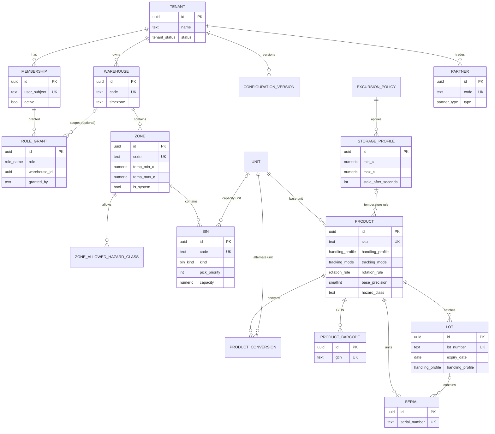
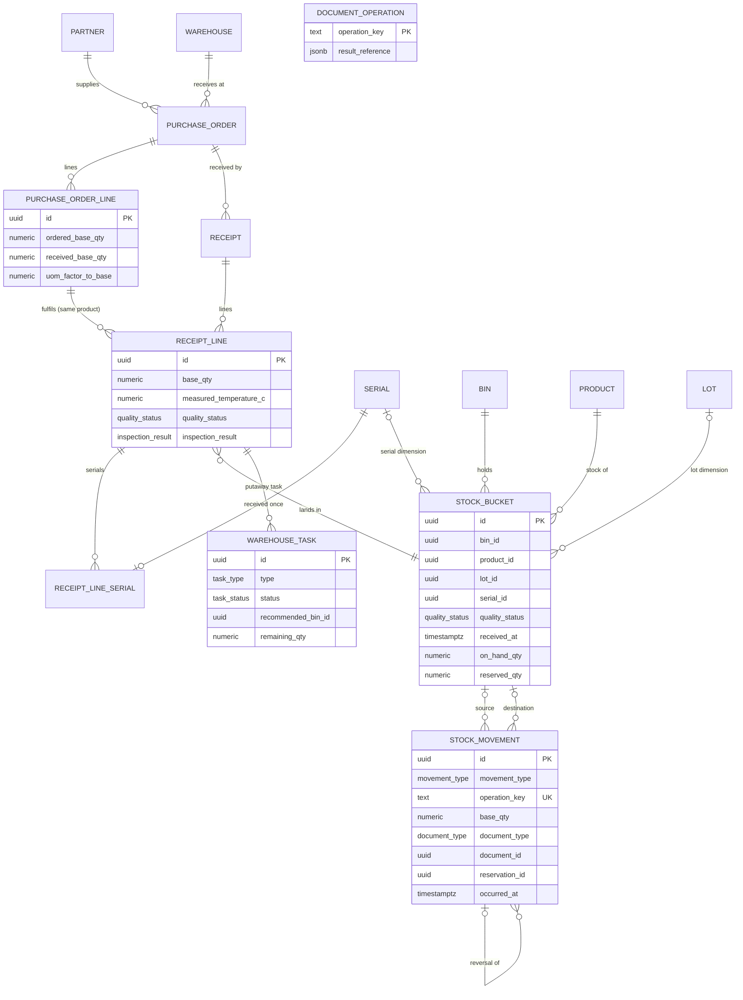
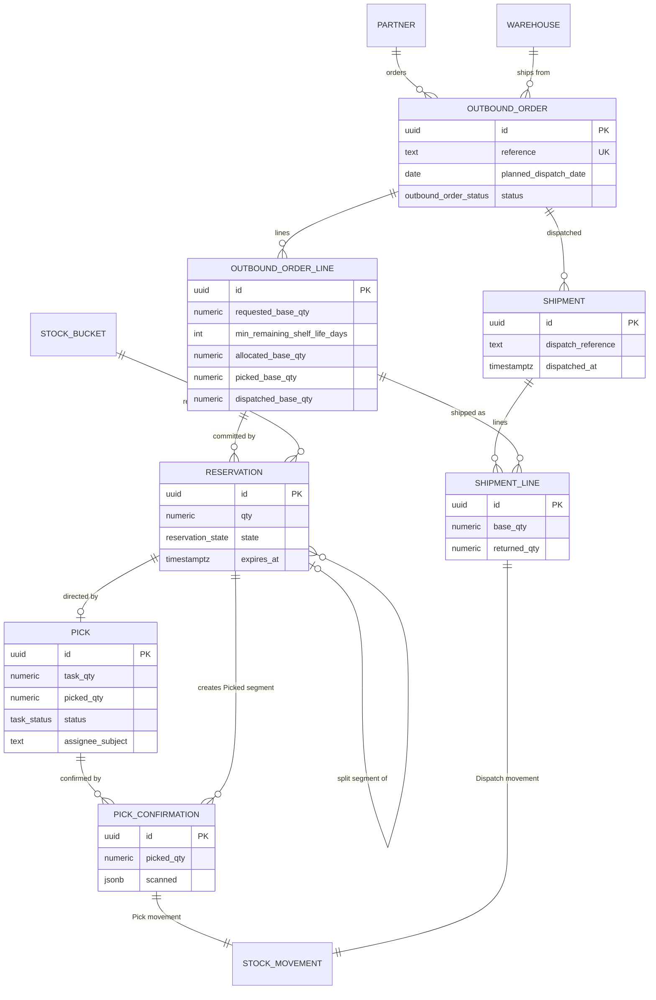
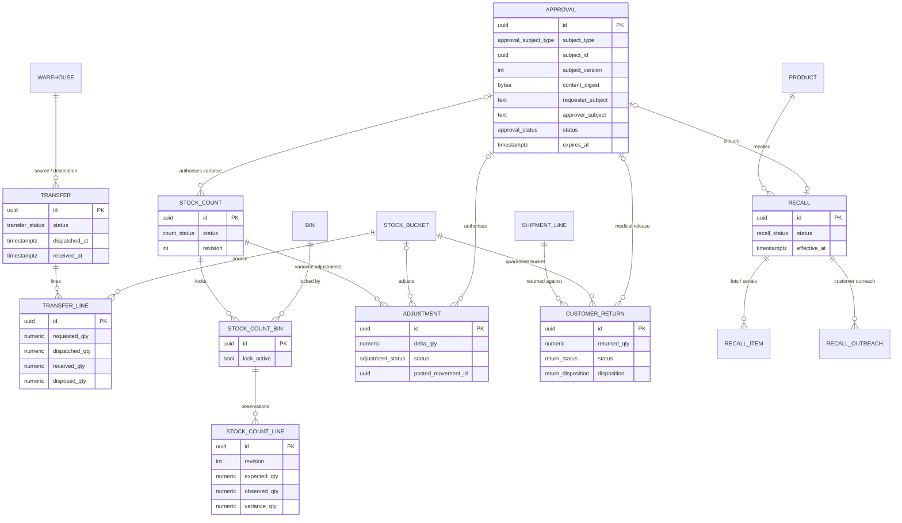
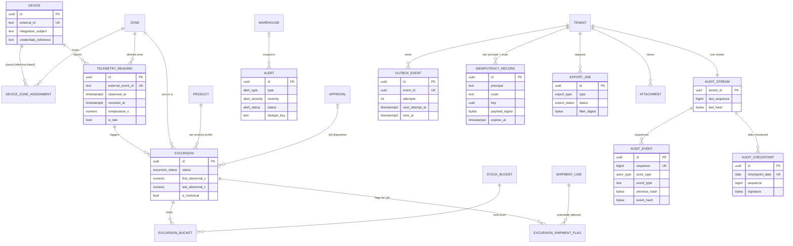

# Entity-relationship model

These diagrams are generated by hand from `db/design/schema-draft.sql`, which is authoritative.
Every tenant-owned entity also has `tenant_id`, and every relationship drawn here is a **composite**
foreign key that includes `tenant_id` (TEN-001). Those columns are left out of the diagrams to keep
them readable. Standard columns (`created_*`, `updated_at`, `version`) are left out too.

## 1. Organization, catalog and locations

## 2. Inbound and stock ledger

`DOCUMENT_OPERATION` stands alone: it holds permanent command keys (STK-007).

## 3. Outbound

## 4. Exceptions, approvals and medical controls

## 5. Telemetry, alerts, audit and integration

`AUDIT_CHECKPOINT` and `AUDIT_STREAM` are related through `tenant_id` only; there is no direct foreign key.
